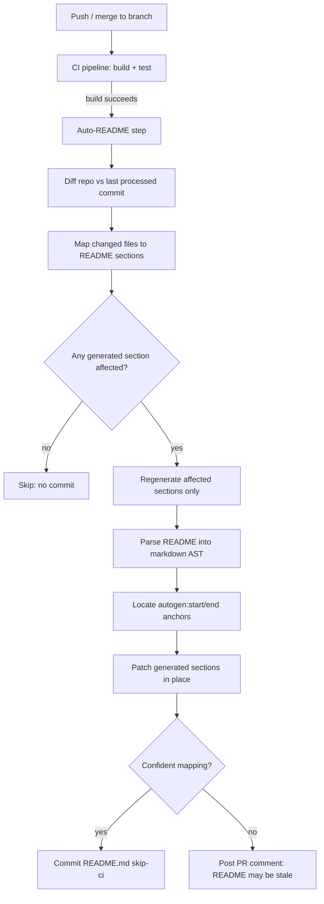

# Auto-README Plugin — Technical Spec

A CI-integrated plugin that regenerates only the machine-owned sections of
`README.md` on every push, leaving human-written prose untouched.

## Overview

Current README generators (readme-ai, various CI actions) do a full LLM
rewrite on every run, which clobbers hand-written prose, badges, and custom
sections. This plugin instead treats the README as a **partially
machine-owned document**: it regenerates only the sections it owns,
incrementally, based on what actually changed in the diff since the last run.

It runs as a post-build CI step. On each push it diffs the repo against the
last commit it processed, maps the changed files to the README sections they
affect, and patches only those sections — leaving everything else, including
free-form human prose, untouched.

## Architecture



The pipeline never rewrites the whole file. It locates the
`<!-- autogen:start:X -->...<!-- autogen:end:X -->` markers for each
generated section, patches only the ones whose source files changed, and
commits with a skip-ci tag so the commit doesn't re-trigger itself.

## Section ownership model

Every README section is either **generated** (owned by the plugin) or
**human** (free text, never touched). Ownership is marked with HTML comment
anchors so the file stays plain markdown and renders normally on GitHub.

| Section | Owner | Source of truth |
| --- | --- | --- |
| Install / run / build commands | Generated | `package.json` scripts, `Makefile`, `Dockerfile`, `pyproject.toml` |
| Public API / CLI surface | Generated | Exported functions, CLI command definitions |
| Dependencies | Generated | Lockfile / manifest |
| Recent changes | Generated | Commit messages since last run |
| Project description, "why this exists" | Human | Free text, never regenerated |
| Contributing / license | Human | Free text, never regenerated |

```markdown
<!-- autogen:start:install -->
## Install

`npm install`
<!-- autogen:end:install -->
```

A change the plugin can't confidently attribute to a section (e.g. an
ambiguous rename) is never guessed — it's flagged in a PR comment instead.

## Configuration

Shipped as a GitHub Action (with a CLI core so it also runs as a pre-push
hook or in other CI systems).

| Option | Default | Purpose |
| --- | --- | --- |
| `trigger` | `post-build` | When the step runs relative to build/test |
| `sections` | all generated sections | Restrict regeneration to a subset |
| `readme-path` | `README.md` | Target file; supports per-package paths in a monorepo |
| `commit-mode` | `skip-ci` | How the update commit avoids re-triggering the pipeline |
| `on-ambiguous` | `comment` | `comment` \| `skip` \| `fail` when a change can't be mapped confidently |
| `monorepo` | `false` | Enables per-package README scoping |

```yaml
- uses: org/auto-readme-action@v1
  with:
    sections: install,api,deps
    on-ambiguous: comment
```

## Failure modes and safeguards

| Risk | Safeguard |
| --- | --- |
| Infinite trigger loop (README commit re-triggers pipeline) | Commit is tagged `[skip ci]`; step also short-circuits when the only changed path is the README itself |
| Two branches both regenerate, causing merge conflicts | Runs on the target branch post-merge, not per-branch |
| Monorepo: one README vs. many | `readme-path` / `monorepo` config scopes generation per package |
| Low-confidence section mapping | Never guessed — posts a PR comment instead of writing |
| Manually edited generated section | Detected via content hash mismatch against last known generated output; flagged, not overwritten silently |

## Rollout plan

1. **Phase 1 — single-repo CLI**: parse markdown AST, detect anchors,
   regenerate install/API/deps sections from a manual run.
2. **Phase 2 — CI integration**: wrap as a GitHub Action, add diff-based
   scoping and skip-ci commit logic.
3. **Phase 3 — ambiguity handling**: content-hash detection for manual
   edits, PR comment fallback for low-confidence mappings.
4. **Phase 4 — monorepo support**: per-package README scoping and config.
5. **Phase 5 — dogfood**: run on this repository's own README for a trial
   period before wider release.

Full interactive version (with live diagram, comments): https://claude.ai/artifact/KVKgpWsXPD5RKL7yrXuutU
